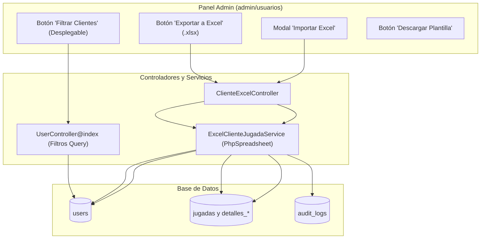

# Plan de Implementación: Filtros Avanzados y Módulo Excel (Export/Import) de Clientes y Jugadas

---

## 1. Visión General del Requerimiento

El objetivo de esta fase es potenciar el panel de administración en la sección de **Gestión de Clientes** ([admin/users/index.blade.php](file:///c:/laragon/www/germanBianchi_agenciaQ/resources/views/admin/users/index.blade.php)) incorporando:

1. **Filtros Avanzados en Menú Desplegable:**
   - Letra inicial del nombre (A-Z).
   - Letra inicial del apellido (A-Z).
   - Cantidad de jugadas a partir de $X$ (mínimo de boletas emitidas).
   - Volumen de dinero a partir de $\$X$ (monto total apostado acumulado).
   - Interfaz con botón desplegable, badge contador de filtros activos y reseteo inmediato.

2. **Módulo Integral de Excel (.xlsx):**
   - **Exportación:** Descarga de un libro Excel completo con dos hojas:
     - *Hoja 1:* Clientes (Datos personales, DNI, saldo, total jugadas, volumen apostado).
     - *Hoja 2:* Jugadas Detalladas (Ticket #, cliente, fecha, modalidades, importe, estado, resultado, premio).
   - **Importación:** Carga de archivo Excel para dar de alta clientes y registrar sus jugadas históricas en una sola operación transaccional.
   - **Descarga de Plantilla:** Botón para bajar un archivo `.xlsx` modelo con la estructura esperada y filas de ejemplo.

---

## 2. Diagrama de Arquitectura y Flujo



---

## 3. Especificación Técnica por Componente

### Módulo A: Filtros Avanzados de Clientes

#### 1. Lógica en [`app/Models/User.php`](file:///c:/laragon/www/germanBianchi_agenciaQ/app/Models/User.php) o Controller:
Crear un scope `scopeFiltrarClientes($query, array $filtros)` que soporte:
- **Letra Inicial del Nombre (`inicial_nombre`):**
  ```php
  $query->where('name', 'LIKE', $filtros['inicial_nombre'] . '%');
  ```
- **Letra Inicial del Apellido (`inicial_apellido`):**
  Dado que el campo `name` contiene `"Nombre Apellido"` (ej: `"Juan Pérez"`), se evalúa la inicial de cualquier palabra secundaria:
  ```php
  $query->where('name', 'LIKE', '% ' . $filtros['inicial_apellido'] . '%');
  ```
- **Cantidad Mínima de Jugadas (`min_jugadas`):**
  Uso del método nativo de Eloquent `has()` sin necesidad de `HAVING` o agrupamientos frágiles:
  ```php
  $query->has('jugadas', '>=', (int) $filtros['min_jugadas']);
  ```
- **Volumen Mínimo de Pesos (`min_volumen`):**
  Subconsulta SQL directa compatible con MySQL y SQLite:
  ```php
  $query->whereRaw(
      '(SELECT COALESCE(SUM(monto_total), 0) FROM jugadas WHERE jugadas.user_id = users.id) >= ?',
      [(float) $filtros['min_volumen']]
  );
  ```

#### 2. Interfaz Visual en [`admin/users/index.blade.php`](file:///c:/laragon/www/germanBianchi_agenciaQ/resources/views/admin/users/index.blade.php):
- Botón **"Filtrar Clientes"** con contador de filtros aplicados.
- Menú desplegable con:
  - Selector/Input de Letra de Nombre (A-Z).
  - Selector/Input de Letra de Apellido (A-Z).
  - Input numérico de "Mínimo de Jugadas" (ej: a partir de 3).
  - Input numérico de "Volumen Total ($)" (ej: a partir de $10.000).
  - Botones "Aplicar Filtros" y "Limpiar".

---

### Módulo B: Exportación e Importación con Excel (.xlsx)

#### 1. Librería Técnica
- Se incorporará **`phpoffice/phpspreadsheet`** (estándar de la industria, compatible con PHP 8.3+, sin conflictos con Laravel 13).

#### 2. Estructura del Libro Excel (.xlsx)

##### Hoja 1: "Clientes"
| ID_Temporal | Nombre | Apellido | DNI | Email | Saldo_Inicial |
| :--- | :--- | :--- | :--- | :--- | :--- |
| `CLI-01` | Roberto | Gómez | 31445566 | roberto@correo.com | 15000.00 |
| `CLI-02` | Silvia | Fernández | 29887766 | silvia@correo.com | 20000.00 |

##### Hoja 2: "Jugadas"
| ID_Cliente_Ref | Modalidad | Numeros_O_Detalle | Jurisdiccion | Posicion | Importe_O_Costo | Estado | Resultado | Premio |
| :--- | :--- | :--- | :--- | :--- | :--- | :--- | :--- | :--- |
| `CLI-01` | quiniela | 4512 | nacion | 1 | 500.00 | procesado | ganadora | 17500.00 |
| `CLI-01` | quini6 | 04,11,18,25,32,41 | | | 1200.00 | procesado | no_ganadora | 0.00 |
| `CLI-02` | lotoplus | 05,12,19,26,33,40 (+Plus: 7) | | | 1500.00 | procesado | pendiente_sorteo | 0.00 |

#### 3. Servicio de Negocio: `app/Services/ExcelClienteJugadaService.php`
- `exportarClientesYJugadas(?array $filtros = null): StreamedResponse`:
  - Genera el archivo con encabezados corporativos dorados/oscuros, anchos de columna autoajustables y formato numérico de moneda.
- `importarDesdeExcel(UploadedFile $archivo): array`:
  - Lee ambas hojas dentro de una transacción (`DB::transaction`).
  - Si el cliente ya existe por DNI o Email, lo asocia; si no existe, lo crea con contraseña `'password'` y rol `'cliente'`.
  - Registra las jugadas vinculadas y sus tablas de detalles correspondientes.
  - Genera registro en `audit_logs` detallando clientes y jugadas procesadas.
  - Retorna un resumen con el conteo de altas exitosas o errores de validación fila por fila.
- `descargarPlantillaEjemplo(): StreamedResponse`:
  - Retorna un Excel listo con 2 clientes y 4 jugadas de ejemplo explicativas.

#### 4. Rutas en [`routes/web.php`](file:///c:/laragon/www/germanBianchi_agenciaQ/routes/web.php):
```php
Route::prefix('admin/usuarios')->middleware(['auth', AdminMiddleware::class])->group(function () {
    Route::get('/exportar', [ClienteExcelController::class, 'exportar'])->name('admin.users.exportar');
    Route::post('/importar', [ClienteExcelController::class, 'importar'])->name('admin.users.importar');
    Route::get('/plantilla-ejemplo', [ClienteExcelController::class, 'descargarPlantilla'])->name('admin.users.plantilla');
});
```

---

## 4. Plan de Ejecución Paso a Paso

1. **Paso 1: Instalación de Dependencia:**
   - Instalar `phpoffice/phpspreadsheet` mediante Composer.
2. **Paso 2: Filtros de Clientes en Backend:**
   - Implementar el scope de filtrado en el modelo `User` o query builder en `UserController@index`.
   - Soporte de paginación con `withQueryString()`.
3. **Paso 3: Vistas y Menú Desplegable:**
   - Integrar botón y panel desplegable de filtros en [`admin/users/index.blade.php`](file:///c:/laragon/www/germanBianchi_agenciaQ/resources/views/admin/users/index.blade.php).
   - Añadir botones de "Exportar a Excel", "Importar" y "Bajar Plantilla".
   - Crear modal visual para arrastrar o seleccionar el archivo `.xlsx` a importar.
4. **Paso 4: Servicio Excel (Exportación, Importación y Plantilla):**
   - Implementar `app/Services/ExcelClienteJugadaService.php`.
   - Crear controlador `app/Http/Controllers/Admin/ClienteExcelController.php`.
5. **Paso 5: Pruebas Automatizadas (Pest):**
   - Crear `tests/Feature/Admin/ClientesFiltrosYExcelTest.php`:
     - Prueba de filtro por inicial de nombre y apellido.
     - Prueba de filtro por mínimo de jugadas y volumen en pesos.
     - Prueba de exportación descargando un `.xlsx` válido.
     - Prueba de importación creando clientes y jugadas en base de datos.
6. **Paso 6: Formateo y Verificación:**
   - Ejecutar `vendor/bin/pint --format agent` y suite de tests completa con `php artisan test --compact`.

