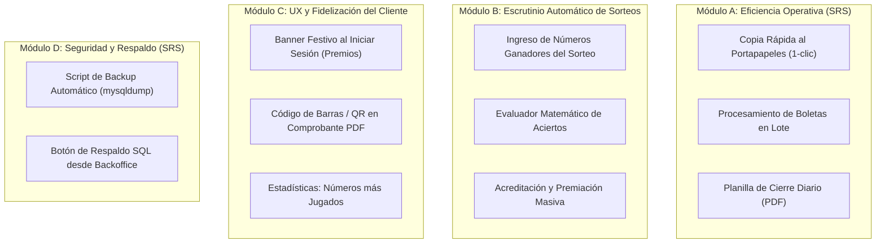

# Plan de Integración: Próximas Fases y Módulos Faltantes

---

## 1. Diagnóstico del Estado Actual del Sistema

Actualmente, la plataforma cuenta con una base sumamente sólida, funcional y testeada (**70 tests automatizados en Pest** con 100% de éxito). Se han cumplido todas las fases centrales:

- **Autenticación y Roles:** Registro completo, validación de DNI/email, control de acceso mediante middleware administrativo y expiración de sesiones.
- **Motor Transaccional de Apuestas:** Las 5 modalidades implementadas con validación matemática en frontend y backend (Quiniela tradicional, Quini 6, Loto Plus con número Plus, Loto 5 y Poceada), token de idempotencia anti-duplicados y generación de jugadas al azar ("Quick Pick").
- **Módulo Financiero y Billetera Virtual:** Control de saldo de usuario en tiempo real, tabla de precios históricos configurable desde el panel, escrutinio manual (boleta ganadora/no ganadora) con acreditación automática de premios a la billetera y matriz analítica de ganancias/pérdidas por categoría.
- **Documentación y Reportes:** Emisión de comprobantes PDF con diseño institucional (Dompdf), notificación SMTP al administrador con registro en `audit_logs` y reenvío manual.
- **Gestión Avanzada de Clientes:** Búsqueda en tiempo real (debounce 250ms) unificando nombres, apellidos, DNI y email, filtros por jugadas mínimas y volumen, exportación e importación integral de Excel (`.xlsx`) en 2 hojas con estilos corporativos y plantilla oficial descargable.

---

## 2. ¿Qué cosas faltan o sugerimos agregar?

Al contrastar la aplicación contra el **SRS original** y las necesidades operativas reales de una agencia de quiniela, identificamos **4 módulos de alto valor** que completan al 100% el alcance y llevan la plataforma a nivel profesional.

---

## 3. Detalle de los Módulos Propuestos

### Módulo A: Eficiencia Operativa del Agenciero (Requisitos del SRS)
*Objetivo:* Facilitar la transcripción y el despacho rápido de boletas sin fricción.

1. **Herramienta de "Copia Rápida" al Portapapeles (Sección 3 del SRS):**
   - El SRS estipula explícitamente: *"herramientas de 'Copia rápida' para trasladar datos al portapapeles... Su función principal es transcribir los datos y gestionar el estado de la jugada"*.
   - **Propuesta:** Agregar en cada fila de la grilla de jugadas un botón interactivo `📋 Copiar datos` que arme una línea estandarizada legible para terminales de lotería (ej: `[Ticket #142] Quiniela Nación Matutina | Núm: 4512 a los 1 | Importe: $500 | Cliente: Juan Pérez`) y muestre un aviso flotante *"¡Copiado al portapapeles!"*.
2. **Procesamiento de Boletas en Lote (Bulk Actions):**
   - Actualmente, el agenciero debe cambiar el estado una por una en el menú desplegable.
   - **Propuesta:** Checkboxes de selección múltiple con acciones masivas:
     - *"Marcar seleccionadas como Procesadas"*.
     - *"Marcar todas las pendientes del día como Procesadas"*.
3. **Planilla de Cierre Diario en PDF (Arqueo de Caja):**
   - El SRS menciona *"funciones de exportación de jugadas a PDF"*. Actualmente solo existe el comprobante individual por boleta.
   - **Propuesta:** Un botón *"Exportar Cierre Diario (PDF)"* que emita una hoja contable consolidada con la fecha, total recaudado por categoría, total de premios pagados y listado resumido de tickets del día.

---

### Módulo B: Motor de Escrutinio Automático de Sorteos (Game Changer)
*Objetivo:* Eliminar la carga manual individual de boletas ganadoras.

- **Problema actual:** Cuando sale el sorteo (ej. Quini 6 o Quiniela), el administrador tiene que revisar boleta por boleta, buscar al cliente y cambiarla manualmente a "Ganadora" escribiendo el premio a mano.
- **Solución propuesta:**
  1. **Panel de Sorteos Oficiales:** El administrador selecciona el juego (ej. *Quiniela Matutina Ciudad*, *Quini 6 Tradicional*) y carga los números oficiales que salieron en la extracción.
  2. **Escrutador Inteligente:** El sistema compara en segundos todas las boletas pendientes de ese juego:
     - Para Quiniela: verifica si el número acertó a la cabeza, a los 5, a los 10 o a los 20, y si salieron 1, 2, 3 o 4 cifras.
     - Para Quini 6 / Loto / Poceada: calcula la cantidad de aciertos (ej. 6, 5 o 4 aciertos).
  3. **Premiación y Billetera Automática:** Marca automáticamente las boletas como *Ganadoras* o *No Ganadoras*, asigna el monto del premio según el multiplicador oficial y acredita el dinero en la billetera virtual del cliente con registro en `audit_logs`.

---

### Módulo C: Experiencia de Usuario y Fidelización del Cliente
*Objetivo:* Generar satisfacción e inmersión visual en el apostador.

1. **Alerta de Premio al Iniciar Sesión (Celebración):**
   - Cuando un cliente ingresa al sistema y tiene boletas recientemente premiadas que no ha visto, se muestra un modal o banner dorado festivo:
     - *"🎉 ¡Felicidades, [Nombre]! Has ganado $17.500 en la boleta #145 de Quiniela. El saldo ya fue acreditado en tu cuenta."*
2. **Código de Barras / QR en el Comprobante PDF:**
   - Incorporar en el comprobante Dompdf un código de barras simulado (Code 128 o QR con el UUID / Ticket ID) y el texto institucional de disclaimer, emulando al 100% el ticket físico térmico de las terminales de lotería.
3. **Sección de Estadísticas y Números Calientes ("Estadísticas de la Agencia"):**
   - En la página principal o en la vista de jugadas: mostrar los números más elegidos por los clientes en la semana y los números que más premios otorgaron.

---

### Módulo D: Seguridad, Respaldo y DevOps (Sección 8 del SRS)
*Objetivo:* Cumplimiento estricto del plan de contingencia del SRS.

1. **Script de Respaldo Automatizado (`backup.bat` / Artisan Command):**
   - El SRS punto 8 especifica: *"Recuperación ante Desastres: Estrategia de backups manuales mediante scripts automáticos de shell/batch que ejecutan 'mysqldump' periódicamente."*
   - **Propuesta:** Crear un comando Artisan `php artisan db:backup` y un script ejecutable `.bat` en Laragon que genere volcados `.sql` timestamped en `storage/backups/`.
2. **Descarga de Backup desde el Backoffice:**
   - Botón protegido en el Backoffice del Administrador para descargar un dump completo de la base de datos con un clic.

---

## 4. Matriz de Prioridad y Esfuerzo

| Módulo | Característica | Prioridad | Impacto | Esfuerzo Estimado |
| :--- | :--- | :---: | :---: | :---: |
| **Módulo A** | Copia Rápida al Portapapeles (SRS) | 🔴 Alta | Alto (Ahorro de tiempo diario) | Muy Bajo |
| **Módulo A** | Procesamiento de Boletas en Lote | 🔴 Alta | Alto (Operación masiva) | Bajo |
| **Módulo A** | Planilla de Cierre Diario en PDF (SRS) | 🟡 Media-Alta | Alto (Contabilidad y cierre) | Medio |
| **Módulo B** | Escrutinio Automático de Sorteos | 🔴 Alta | Muy Alto (Automatización real) | Medio |
| **Módulo C** | Banner de Felicitación / Premios | 🟡 Media | Medio (Mejora de UX) | Bajo |
| **Módulo C** | Código de Barras / QR en Comprobante PDF | 🟢 Media-Baja | Visual / Realismo | Bajo |
| **Módulo D** | Backup de Base de Datos (mysqldump - SRS) | 🟡 Media | Seguridad y Entrega SRS | Bajo |

---

## 5. Recomendación de Próximo Paso

Para maximizar el impacto inmediato, sugerimos avanzar con:

1. **Paso Inmediato 1 (Operativo):** Implementar la **Copia Rápida al Portapapeles** y el **Procesamiento de Jugadas en Lote** en el panel de administrador.
2. **Paso Inmediato 2 (Cierre y Contabilidad):** Generar la **Planilla de Cierre Diario en PDF** para el arqueo de caja de la agencia.
3. **Paso Inmediato 3 (Simulación Completa):** Incorporar el **Módulo de Sorteos y Escrutinio Automático**.

